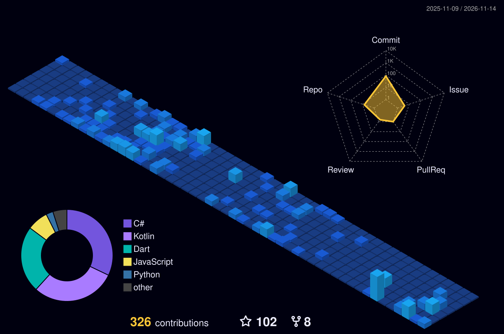

<!-- Header -->

  

  

  
  
  
  

  
  
  

---

### 🧑‍💻 About me

- 🛠️ Full-stack developer who loves building **small, useful tools** people actually use every day
- 🔭 Currently hacking on [**Monitor Remote**](https://github.com/samir-dahal/monitor-remote) and [**MilkDrop for Android**](https://github.com/samir-dahal/MilkDrop)
- 🗓️ Maker of [**Sambat Widget**](https://github.com/samir-dahal/SambatWidget.Windows), a Nepali calendar widget for Windows
- 💬 Ask me anything [**here**](https://github.com/samir-dahal/samir-dahal/issues)

### 🧰 Tech stack

   
  

### 📊 GitHub stats

  
  

  

### 🚀 Featured projects

  
  
  
  

### 🐍 Contribution snake

  <picture>
    <source media="(prefers-color-scheme: dark)" srcset="https://raw.githubusercontent.com/samir-dahal/samir-dahal/output/snake-dark.svg" />
    
  </picture>

<!-- Footer -->

  

